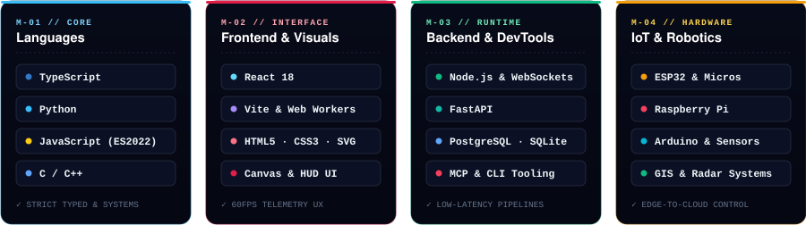

  <!-- HERO AEROSPACE TELEMETRY BANNER -->
  

   

  <!-- LIVE OBSIDIAN ACTION STRIP -->
  

    
    &nbsp;
    
    &nbsp;
    
    &nbsp;
    
  

   

  <!-- BESPOKE MACOS OBSIDIAN TELEMETRY TERMINAL -->
  

    

  <!-- SECTION 01: FLAGSHIP ENGINEERING SYSTEMS -->
  

   

  <!-- 2x2 BORDERLESS CLICKABLE PROJECT DOSSIER GRID -->
  

    &nbsp;&nbsp;
  

  

    &nbsp;&nbsp;
  

   

  <!-- SECTION 02: TECHNICAL ARCHITECTURE & ARSENAL -->
  

   

  

    

  <!-- SECTION 03: LIVE GITHUB TELEMETRY & VELOCITY -->
  

   

  <!-- LIVE OBSIDIAN TELEMETRY CONTRIBUTION GRAPH -->
  

    
  

  

    
    &nbsp;
    
  

  

    
  

   

  <!-- FOOTER SIGN-OFF RIBBON -->
  

   

  
    
  

