

  <!-- HERO MONOGRAPH -->
  <a href="https://github.com/shouryaupadhyay2029/BLACKBOX">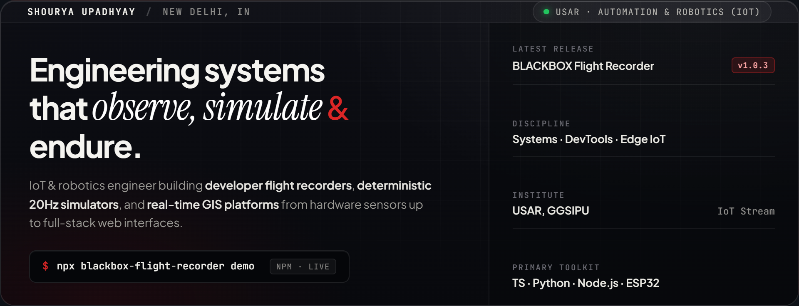</a>

   

  <!-- SINGLE-ROW BESPOKE MONOCHROME LINK BAR -->
  

    <a href="https://www.npmjs.com/package/blackbox-flight-recorder">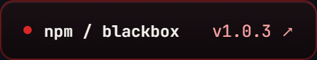</a>&nbsp;&nbsp;&nbsp;
  

   

  <!-- 01 · SELECTED WORK -->
  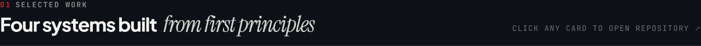

   

  <!-- 2x2 CLICKABLE FLAGSHIP PRODUCT SHOWCASE -->
  

    <a href="https://github.com/shouryaupadhyay2029/BLACKBOX">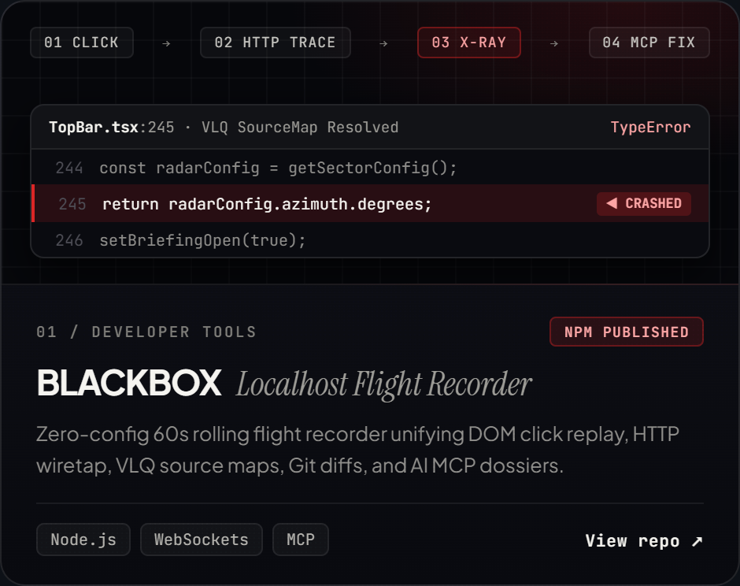</a>&nbsp;&nbsp;<a href="https://github.com/shouryaupadhyay2029/TEJAS">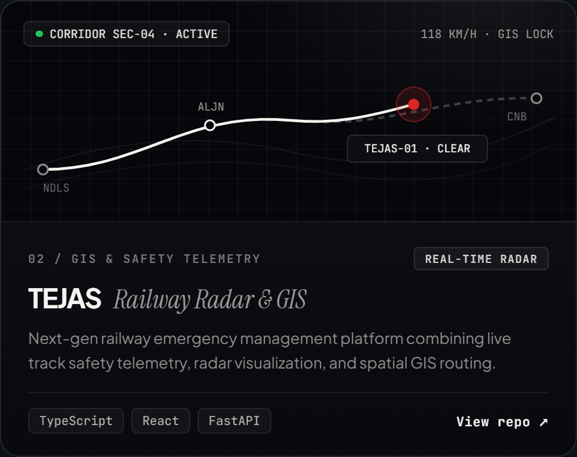</a>
  

  

    <a href="https://github.com/shouryaupadhyay2029/mod_drones">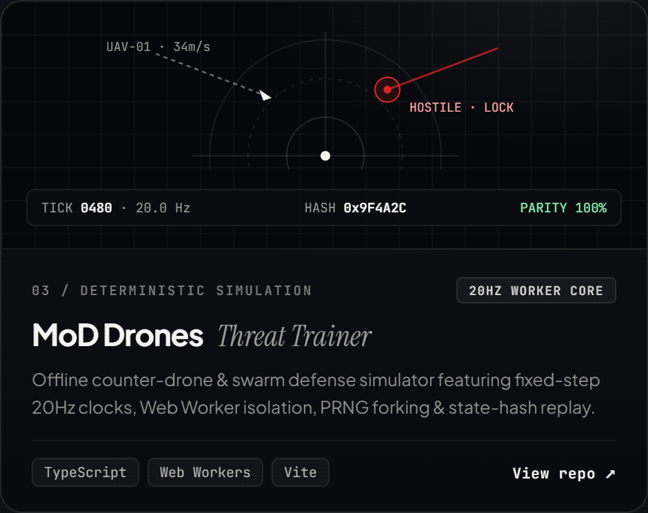</a>&nbsp;&nbsp;<a href="https://github.com/shouryaupadhyay2029/SAKSHAM">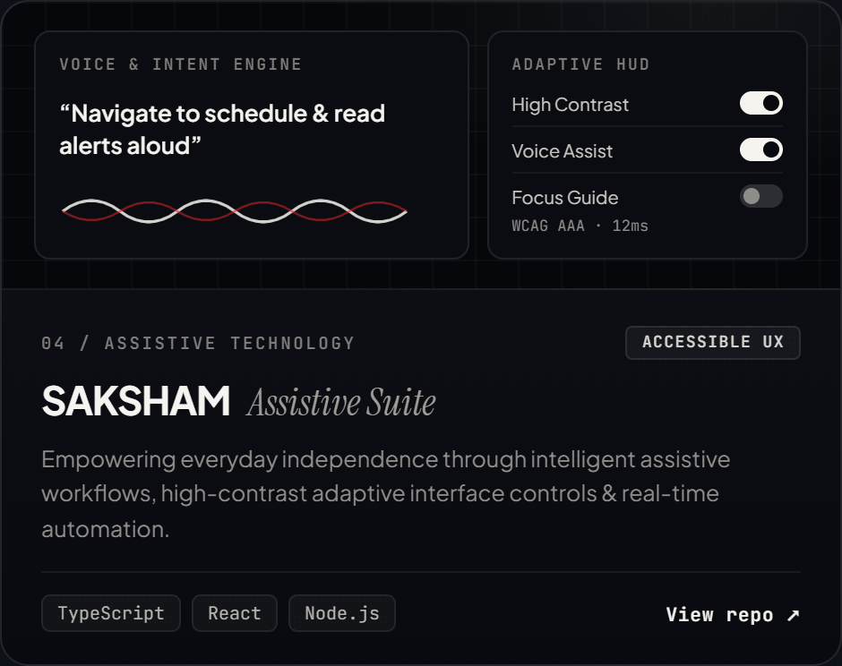</a>
  

   

  <!-- 02 · CAPABILITIES & ARCHITECTURE -->
  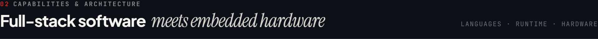

   

  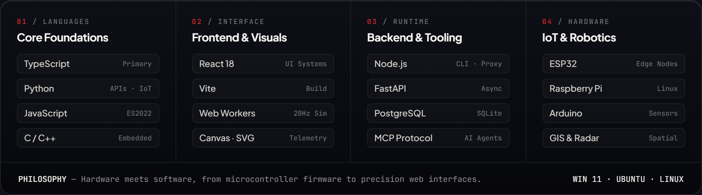

    

  <!-- 03 · LIVE OPEN-SOURCE CADENCE -->
  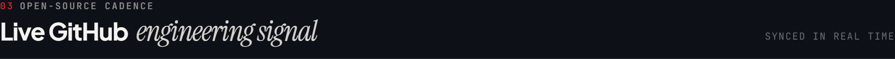

   

  

    
  

  

    &nbsp;&nbsp;
  

   

  <!-- QUIET LUXURY EDITORIAL FOOTER -->
  <a href="mailto:upadhyayshourya352@gmail.com">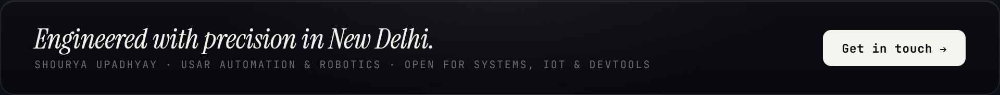</a>

